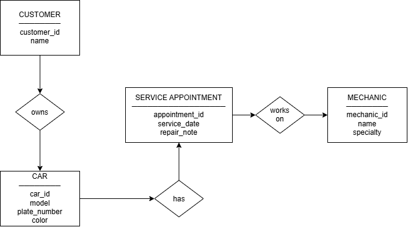

# INFOMAN1 – Week 2 Lab: Conceptual ERD Case Study

**Name:** [Brianna Bustamante]
**Student ID:** [2510236]
**Section:** [BSIT - 2]

## Task 1 — Candidate Entities

| Entity              | Justification                                                                                                                                                                                        |
| ------------------- | ---------------------------------------------------------------------------------------------------------------------------------------------------------------------------------------------------- |
| Customer            | The scenario states that the shop has many customers and each customer may bring one or more cars, making Customer a distinct entity with its own records.                                           |
| Car                 | The scenario states that each car has a model, plate number, and color and belongs to exactly one customer, giving Car its own attributes and identity.                                              |
| Mechanic            | The scenario states that the shop employs several mechanics, each with a name and specialty, making Mechanic a distinct entity.                                                                      |
| Service Appointment | The scenario states that a mechanic works on a car during a scheduled service appointment and that each appointment has a date and repair note, making it a distinct record with its own attributes. |

## Task 2 — Attributes per Entity

### Customer

* Primary Key: customer_id
* Attributes:

  * customer_id — Domain: numeric
  * name — Domain: text

### Car

* Primary Key: car_id
* Attributes:

  * car_id — Domain: numeric
  * model — Domain: text
  * plate_number — Domain: text
  * color — Domain: text

### Mechanic

* Primary Key: mechanic_id
* Attributes:

  * mechanic_id — Domain: numeric
  * name — Domain: text
  * specialty — Domain: text

### Service Appointment

* Primary Key: appointment_id
* Attributes:

  * appointment_id — Domain: numeric
  * service_date — Domain: date
  * repair_note — Domain: text

## Task 3 — Relationships

| Relationship (verb phrase) | Between                        | Cardinality | Checked both directions?                                                                                |
| -------------------------- | ------------------------------ | ----------- | ------------------------------------------------------------------------------------------------------- |
| owns                       | Customer ↔ Car                 | 1:N         | Yes — one customer may own one or more cars, while each car belongs to exactly one customer.            |
| has                        | Car ↔ Service Appointment      | 1:N         | Yes — one car may have many service appointments over time, while each appointment is for one car.      |
| works on                   | Mechanic ↔ Service Appointment | 1:N         | Yes — one mechanic may work on many service appointments, while each appointment involves one mechanic. |

## Task 4 — Conceptual ERD

